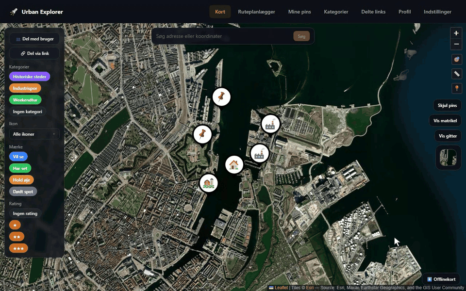
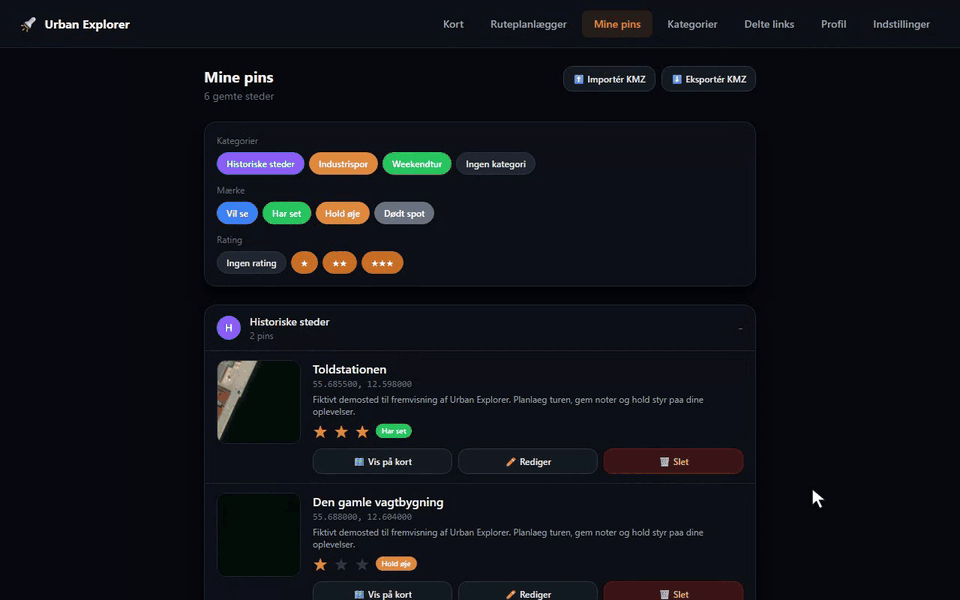
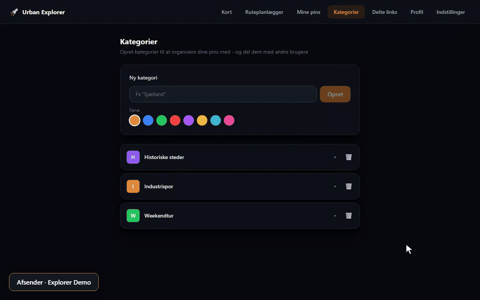

# Urban Explorer

Find, mark and organize places on a satellite map. Save notes, photos and videos, plan trips, and share selected pins or categories. Runs standalone with Docker Compose or through FjordHub on desktop and mobile. The interface currently uses Danish labels.

## See it in action

### Explore the map

Filter places by category and open a pin to see notes, rating and status.



### Manage your pins

Find places in My pins, edit their status and save changes.



### Share with others

Open Share with user in the map sidebar, choose a category and grant view access. The recipient selects Shared with you, filters shared categories and opens pin details. Switch between your own and shared maps directly in the sidebar.



Recorded in a separate demo with fictional places and data.

## Features

### Maps and exploration

- Satellite, street and outdoor maps using Esri or MapTiler.
- Danish aerial/oblique imagery from Dataforsyningen when configured, plus cadastral parcel details.
- Address/coordinate search and current location.
- Pin clustering and category, icon, status and rating filters.
- A 1 × 1 km search grid to track reviewed areas.
- Distance measurement and drawn/saved routes associated with pins.

### Pins, categories and media

- Names, descriptions, coordinates and ratings up to three stars.
- Want to visit, Visited, Keep an eye on and Dead spot statuses.
- Pin icons and multiple categories with custom colors.
- My pins filtering/editing and return-to-map navigation.
- Photos/videos with an expanded viewer; open coordinates in Google Maps or the oblique-imagery service.

### Trip planning

Choose pins, start/end points and calculate driving routes using Valhalla, including optional waypoint optimization. Inspect distance, estimated time and legs, save/reopen routes and launch Google Maps navigation to stops.

The bundled Valhalla container builds **Denmark** road data on first start. Routing waits for that initial download/build. Each calculation accepts at most 50 points. Maps and pins remain usable while routing data is prepared.

### Sharing

Share categories, individual or uncategorized pins with view/edit permissions. Create public links to selected pins and manage/revoke them under Shared links. Recipients can copy shared pins into their own collection. Map sharing and shared-pin category filters are available from the sidebar.

### Import/export

Import point placemarks from multiple KML/KMZ files, review candidates before saving, and export KMZ with descriptions, pin icons and associated media. Imports accept up to 25 MB and 2,000 points; this is not a complete database restore.

### Offline maps and mobile

Download a chosen GeoDanmark aerial-map area with pins and relevant saved routes. Select one of four detail levels and follow size/progress. Reopen downloaded areas in the same browser without a connection. Mobile navigation and home-screen PWA installation are available where supported.

Offline downloads require a Dataforsyningen token and internet while downloading. Packages remain in that device's browser storage, not server PostgreSQL. Preserve browser data and download on the intended device. Offline viewing does not calculate new driving routes without a server connection.

## Install through FjordHub

The [manifest](fjordhub.json) defines port, map keys, upload directory and generated secrets. Hub supplies shared users, SSO, access grants and password recovery. Map provider/keys remain configurable in the app.

First-login email confirmation and replacement of a temporary password can be completed in the app. Five-attempt login limits and temporary lockout apply. Existing sessions are checked against current Hub access; revocation blocks requests and invalidates login, while Hub outages do not authorize stale membership.

Hub administrators can require an email update on next opening. Returning to the app also checks existing logins and shows a mandatory form. Saving a valid, unique address clears the shared requirement across updated apps. Update Hub and Urban Explorer together.

## Standalone Docker deployment

Requires Git, Docker and Compose; Docker Desktop can be used on Windows.

```sh
git clone https://github.com/qlerup/urban-explorer.git
cd urban-explorer
```

Generate secrets **only for a new installation**:

```powershell
.\scripts\generate-secrets.ps1
```

Or on Linux/macOS:

```sh
bash scripts/generate-secrets.sh
```

The generator writes `.env` with `DB_PASSWORD`, `JWT_SECRET` and `ENCRYPTION_KEY`, overwriting the file. Do not run it during an update: preserve the original key so saved encrypted data remains readable.

Adjust deployment settings while retaining generated secrets:

```dotenv
APP_PORT=3001
TZ=Europe/Copenhagen
UPLOADS_HOST_DIR=./data/uploads
MAPTILER_KEY=
DATAFORSYNINGEN_TOKEN=
```

Esri is the default and requires no MapTiler key. Dataforsyningen is optional for Danish map services/offline areas. `UPLOADS_HOST_DIR` may be local disk or an already mounted NAS/NFS share, writable by UID/GID 1001; without it, Compose uses the media volume.

```sh
docker compose up -d --build
docker compose ps
docker compose logs -f app valhalla
```

Open `http://localhost:3001` (or the chosen port), create the first administrator, then manage users under Settings. First-user setup closes after creation. Other devices require an HTTPS reverse proxy: production login uses Secure cookies and PWA/offline features need a secure browser context. Localhost is suitable for local testing.

## Settings and configuration

Administrators manage map providers/keys, SMTP and users. Forgot password can be enabled/disabled. Standalone reset codes use configured mail delivery; managed recovery uses Hub. Standalone mail settings support the available SMTP/Resend configuration and require a confirmed test send before saving.

See [.env.example](.env.example) and [docker-compose.yml](docker-compose.yml).

| Variable | Purpose |
| --- | --- |
| `DB_PASSWORD` | Installation-specific database password. |
| `JWT_SECRET` | Session-signing secret. |
| `ENCRYPTION_KEY` | Original encryption key; preserve for updates/recovery. |
| `APP_PORT` | Host web port, default 3001. |
| `TZ` | Timezone, default Europe/Copenhagen. |
| `UPLOADS_HOST_DIR` | Host media directory; otherwise `uploads_data`. |
| `MAPTILER_KEY` | Optional provider key, also configurable in Settings. |
| `DATAFORSYNINGEN_TOKEN` | Optional Danish-map token, also configurable in Settings. |
| `FJORDHUB_URL`, `FJORDHUB_API_KEY` | Managed integration supplied by Hub. |
| `FJORDHUB_APP_ID` | Managed app ID, `urban-explorer`. |

Compose sets internal `DATABASE_URL` and `VALHALLA_URL=http://valhalla:8002`; adjust for other deployments. Settings saved through the UI live in PostgreSQL, not only `.env`.

## Data, updates and backup

| Storage | Contents |
| --- | --- |
| `postgres_data` | Users, pins, categories, shares, routes and settings. |
| `UPLOADS_HOST_DIR` / `uploads_data` | Uploaded photos/videos. |
| `valhalla_data` | Downloaded/built routing data reused on restart. |
| Browser storage | Device-specific offline areas. |

Back up PostgreSQL, media and `.env`, including the original encryption key. KMZ does not replace a complete user/share/settings backup.

```sh
git pull --ff-only
docker compose up -d --build
```

Startup ensures the database schema. Preserve volumes/secrets; managed deployments update through Hub.

## Technology and structure

Next.js 15, React 19, TypeScript, PostgreSQL 16/PostGIS, Leaflet/OpenLayers and Valhalla. Images optimize to WebP up to 2560 pixels per dimension. Video inputs include MP4, M4V, MOV, WebM, MKV, AVI and 3GP; playback depends on browser codecs. Content is validated, larger uploads use chunks and media APIs enforce pin/share permissions.

Argon2id passwords, signed JWTs in HttpOnly cookies, temporary lockout and AES-256-GCM encryption protect account/recovery data. Offline viewing uses service workers, Cache Storage and IndexedDB.

`app/src/app/` holds pages/APIs, `app/src/components/` the map/pin/route/sharing UI, and `app/src/lib/` data/auth/media/offline integrations. `app/src/instrumentation.ts` ensures startup schema; `middleware.ts` checks access. `db/`, `valhalla/`, `scripts/`, `docs/demo/` and `app/public/` hold schema, routing, helpers, demos and PWA assets. See [branding/README.md](branding/README.md).
